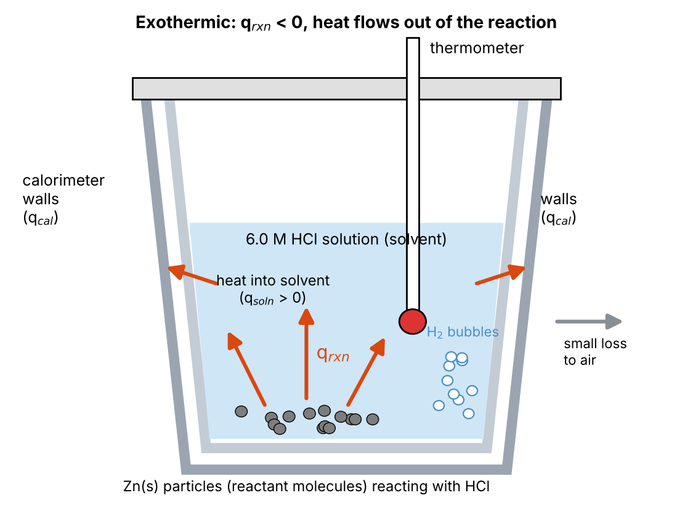

# Abstract

Calorimetry is a way of measuring the heat a reaction gives off or takes in by tracking the temperature change of an insulated bath of liquid around it. The formation of zinc oxide from zinc and oxygen is hard to measure directly because it releases a lot of heat, so the goal of this experiment was to find its enthalpy indirectly using Hess's Law. A styrofoam coffee-cup calorimeter was first calibrated by mixing 40.00 mL of hot water (50.0 °C) with 40.00 mL of room temperature water over three trials. Two of the trials gave negative calorimeter constants, which is not physically possible, so they were discarded and the Trial 3 value of 2.31 J/°C was used. Next, 0.100 g of zinc powder and 0.399 g of zinc oxide were each reacted with 30.00 mL of 6.0 M HCl. The zinc reaction raised the temperature by 2.5 °C and gave an enthalpy change of −209 kJ/mol, and the zinc oxide reaction raised the temperature by 3.6 °C and gave −93.9 kJ/mol. Combining these two values with the known formation enthalpy of water (−285.8 kJ/mol) gave an experimental enthalpy for the oxidation of zinc of −401 kJ/mol. Compared to the accepted value of −350.5 kJ/mol, this is a percent error of 14.4%. Since the answer has the correct sign and lands within about 15% of the accepted value, the results support coffee-cup calorimetry combined with Hess's Law as a useful way to measure reaction enthalpies, even with simple equipment. Most of the error likely comes from heat lost to the surroundings, the small temperature changes measured, the thermometer's limited precision, and having only one usable calibration trial.

# Data and Results

Table 1. Determination of the calorimeter constant.

| | Trial 1 | Trial 2 | Trial 3 |
|:--|--:|--:|--:|
| Volume of hot water, *V*~hot~ (mL) | 40.00 | 40.00 | 40.00 |
| Temperature of hot water, *T*~hot~ (°C) | 50.0 | 50.0 | 50.0 |
| Volume of cold water, *V*~cold~ (mL) | 40.00 | 40.00 | 40.00 |
| Temperature of cold water, *T*~cold~ (°C) | 20.3 | 20.3 | 20.8 |
| Final temperature, *T*~final~ (°C) | 35.8 | 35.3 | 35.3 |
| Δ*T*~hot~ (°C) | −14.2 | −14.7 | −14.7 |
| Δ*T*~cold~ (°C) | 15.5 | 15.0 | 14.5 |
| Δ*T*~cal~ (°C) | 15.5 | 15.0 | 14.5 |
| *q*~hot~ (J) | −2377 | −2460 | −2460 |
| *q*~cold~ (J) | 2594 | 2510 | 2427 |
| *q*~cal~ (J) | −217.6 | −50.2 | 33.5 |
| *C*~cal~ (J/°C) | −14.04 | −3.35 | 2.31 |
| *C*~cal~ used (Trial 3 only) (J/°C) | | | 2.31 |
| Standard deviation *C*~cal~ (J/°C) | N/A (one trial) | | |

Table 2. Calorimetry of the reaction of zinc with hydrochloric acid.

| | Value |
|:--|--:|
| Mass of Zn, *m*~Zn~ (g) | 0.100 |
| Moles of Zn (mol) | 1.53 × 10^−3^ |
| Concentration of HCl (M) | 6.0 |
| Volume of HCl, *V*~HCl~ (mL) | 30.00 |
| Temperature of HCl, *T*~init~ (°C) | 20.0 |
| Final temperature, *T*~final~ (°C) | 22.5 |
| Δ*T* (°C) | 2.5 |
| *q*~rxn~ (J) | −320 |
| Enthalpy change, Δ*H* (kJ/mol) | −209 |

Table 3. Calorimetry of the reaction of zinc oxide with hydrochloric acid.

| | Value |
|:--|--:|
| Mass of ZnO, *m*~ZnO~ (g) | 0.399 |
| Moles of ZnO (mol) | 4.90 × 10^−3^ |
| Concentration of HCl (M) | 6.0 |
| Volume of HCl, *V*~HCl~ (mL) | 30.00 |
| Temperature of HCl, *T*~init~ (°C) | 20.4 |
| Final temperature, *T*~final~ (°C) | 24.0 |
| Δ*T* (°C) | 3.6 |
| *q*~rxn~ (J) | −460 |
| Enthalpy change, Δ*H* (kJ/mol) | −93.9 |

# Discussion

Before measuring any reaction, the calorimeter itself had to be calibrated, since the cups and lid can soak up some of the heat. The idea is a simple heat balance. When hot water and cold water are mixed in an insulated cup, the heat given off by the hot water has to go somewhere, either into the cold water or into the calorimeter walls. Since energy is conserved, all three heats have to add up to zero:

$$q_{hot} + q_{cold} + q_{cal} = 0$$

Trial 3 is used as the example here, since it was the only trial that gave a physically reasonable result (more on that below). The heat for each water sample is found with *q* = *mc*Δ*T*, where the mass of water is taken from its volume using a density of 1.00 g/mL (so 40.00 mL is 40.00 g) and *c* is 4.184 J/g·°C. The hot water cooled from 50.0 °C to 35.3 °C, so

$$\Delta T_{hot} = T_{final} - T_{hot} = 35.3\,^{\circ}\mathrm{C} - 50.0\,^{\circ}\mathrm{C} = -14.7\,^{\circ}\mathrm{C}$$

$$q_{hot} = m_{hot}\,c\,\Delta T_{hot} = (40.00\ \mathrm{g})(4.184\ \mathrm{J/g\cdot ^{\circ}C})(-14.7\,^{\circ}\mathrm{C}) = -2460\ \mathrm{J}$$

The cold water warmed from 20.8 °C to 35.3 °C, so

$$\Delta T_{cold} = T_{final} - T_{cold} = 35.3\,^{\circ}\mathrm{C} - 20.8\,^{\circ}\mathrm{C} = 14.5\,^{\circ}\mathrm{C}$$

$$q_{cold} = m_{cold}\,c\,\Delta T_{cold} = (40.00\ \mathrm{g})(4.184\ \mathrm{J/g\cdot ^{\circ}C})(14.5\,^{\circ}\mathrm{C}) = 2427\ \mathrm{J}$$

Rearranging the heat balance gives the heat taken in by the calorimeter. The unrounded values of *q*~hot~ and *q*~cold~ (−2460.2 J and 2426.7 J) were carried through here so rounding would not throw off the small difference between them:

$$q_{cal} = -(q_{hot} + q_{cold}) = -(-2460\ \mathrm{J} + 2427\ \mathrm{J}) = 33.5\ \mathrm{J}$$

The calorimeter starts at room temperature along with the cold water, so its temperature change is the same as the cold water's (Δ*T*~cal~ = 14.5 °C). Dividing the heat by this temperature change gives the calorimeter constant:

$$C_{cal} = \frac{q_{cal}}{\Delta T_{cal}} = \frac{33.5\ \mathrm{J}}{14.5\,^{\circ}\mathrm{C}} = 2.31\ \mathrm{J/^{\circ}C}$$

The same calculation for Trials 1 and 2 gave −14.04 J/°C and −3.35 J/°C. A negative heat capacity is not physically possible, since it would mean the calorimeter walls gave off heat while they were warming up. In those two trials the cold water seemed to gain more heat than the hot water lost, which can only happen through measurement error. The most likely reasons are that the thermometer could only be read to 0.1 °C, that the hot water cooled a little below 50.0 °C while it was being poured, and that the final temperature was read before the mixture fully settled. Because of this, Trials 1 and 2 were thrown out, and only the Trial 3 value of 2.31 J/°C was used as the calorimeter constant for the rest of the calculations. With only one usable trial, a standard deviation cannot be calculated. Even this value is small, which makes sense for nested styrofoam cups, since they are good insulators and do not take in much heat.

With the calorimeter constant set, the enthalpy of each reaction with HCl could be found. The reaction of zinc with hydrochloric acid is

$$\mathrm{Zn(s) + 2\,HCl(aq) \rightarrow ZnCl_2(aq) + H_2(g)} \qquad \Delta H_A$$

and the reaction of zinc oxide with hydrochloric acid is

$$\mathrm{ZnO(s) + 2\,HCl(aq) \rightarrow ZnCl_2(aq) + H_2O(l)} \qquad \Delta H_B$$

This time the reaction is the system, and the solution and calorimeter walls are the surroundings. Figure 1 shows how heat moves in the cup during the zinc reaction. The zinc particles react at the bottom, and since the reaction is exothermic, heat flows out of them into the HCl solution, and from the solution into the calorimeter walls. A little heat also escapes through the walls to the air, but that is assumed to be negligible. So the same kind of heat balance applies as before: the heat released by the reaction, plus the heat absorbed by the solution and the walls, adds up to zero.

{width=5.5in}

$$q_{rxn} + q_{soln} + q_{cal} = 0$$

Rearranging and writing each surroundings term in terms of the measured temperature change gives

$$q_{rxn} = -(q_{soln} + q_{cal}) = -(m_{soln}\,c\,\Delta T + C_{cal}\,\Delta T)$$

The solution was treated like water, with a density of 1.00 g/mL and a specific heat of 4.184 J/g·°C, so 30.00 mL of HCl is 30.00 g. The mass of the metal was left out since it is tiny compared to the solution. For zinc, the temperature went from 20.0 °C to 22.5 °C:

$$\Delta T = T_{final} - T_{init} = 22.5\,^{\circ}\mathrm{C} - 20.0\,^{\circ}\mathrm{C} = 2.5\,^{\circ}\mathrm{C}$$

$$q_{rxn} = -\left[(30.00\ \mathrm{g})(4.184\ \mathrm{J/g\cdot ^{\circ}C})(2.5\,^{\circ}\mathrm{C}) + (2.31\ \mathrm{J/^{\circ}C})(2.5\,^{\circ}\mathrm{C})\right] = -(313.8\ \mathrm{J} + 5.8\ \mathrm{J}) = -320\ \mathrm{J}$$

To turn this into a molar enthalpy, the heat is divided by the moles of zinc that reacted. HCl was in large excess (0.18 mol compared to about 0.0015 mol of Zn), so all of the zinc reacted:

$$n_{Zn} = \frac{0.100\ \mathrm{g}}{65.38\ \mathrm{g/mol}} = 1.53 \times 10^{-3}\ \mathrm{mol}$$

$$\Delta H_A = \frac{q_{rxn}}{n_{Zn}} = \frac{-320\ \mathrm{J}}{1.53 \times 10^{-3}\ \mathrm{mol}} \times \frac{1\ \mathrm{kJ}}{1000\ \mathrm{J}} = -209\ \mathrm{kJ/mol}$$

The same steps were used for zinc oxide, where the temperature went from 20.4 °C to 24.0 °C:

$$\Delta T = 24.0\,^{\circ}\mathrm{C} - 20.4\,^{\circ}\mathrm{C} = 3.6\,^{\circ}\mathrm{C}$$

$$q_{rxn} = -\left[(30.00\ \mathrm{g})(4.184\ \mathrm{J/g\cdot ^{\circ}C})(3.6\,^{\circ}\mathrm{C}) + (2.31\ \mathrm{J/^{\circ}C})(3.6\,^{\circ}\mathrm{C})\right] = -(451.9\ \mathrm{J} + 8.3\ \mathrm{J}) = -460\ \mathrm{J}$$

$$n_{ZnO} = \frac{0.399\ \mathrm{g}}{81.38\ \mathrm{g/mol}} = 4.90 \times 10^{-3}\ \mathrm{mol}$$

$$\Delta H_B = \frac{-460\ \mathrm{J}}{4.90 \times 10^{-3}\ \mathrm{mol}} \times \frac{1\ \mathrm{kJ}}{1000\ \mathrm{J}} = -93.9\ \mathrm{kJ/mol}$$

Both reactions are exothermic, which matches the temperature going up in both cases and the bubbling seen with the zinc.

The reaction we actually wanted was the oxidation of zinc to zinc oxide:

$$\mathrm{Zn(s) + \tfrac{1}{2}\,O_2(g) \rightarrow ZnO(s)} \qquad \Delta H_{rxn} = ?$$

This one is hard to run directly in a coffee cup, but because enthalpy is a state function, it does not matter what path is taken from reactants to products. That is the main idea behind Hess's Law, and it means the target reaction can be built by adding up other reactions whose enthalpies are known. Along with the two measured reactions, the formation of water is needed, using its standard enthalpy of formation:

$$\mathrm{H_2(g) + \tfrac{1}{2}\,O_2(g) \rightarrow H_2O(l)} \qquad \Delta H_C = -285.8\ \mathrm{kJ/mol}$$

Reaction A is kept as written since it has Zn(s) on the reactant side. Reaction B is flipped so ZnO(s) ends up as a product, and flipping a reaction flips the sign of its enthalpy. Reaction C is used as written to supply the oxygen and use up the H~2~ made in Reaction A:

$$\mathrm{Zn(s) + 2\,HCl(aq) \rightarrow ZnCl_2(aq) + H_2(g)} \qquad \Delta H_A = -209\ \mathrm{kJ/mol}$$

$$\mathrm{ZnCl_2(aq) + H_2O(l) \rightarrow ZnO(s) + 2\,HCl(aq)} \qquad -\Delta H_B = +93.9\ \mathrm{kJ/mol}$$

$$\mathrm{H_2(g) + \tfrac{1}{2}\,O_2(g) \rightarrow H_2O(l)} \qquad \Delta H_C = -285.8\ \mathrm{kJ/mol}$$

When these are added together, the 2 HCl, ZnCl~2~, H~2~, and H~2~O all show up on both sides and cancel out, which leaves just Zn(s) + ½ O~2~(g) → ZnO(s). Since the reactions add up to the target, their enthalpies add up the same way:

$$\Delta H_{rxn} = \Delta H_A + (-\Delta H_B) + \Delta H_C$$

$$\Delta H_{rxn} = (-209\ \mathrm{kJ/mol}) + (93.9\ \mathrm{kJ/mol}) + (-285.8\ \mathrm{kJ/mol}) = -401\ \mathrm{kJ/mol}$$

The target reaction is the formation of ZnO from its elements, so its theoretical enthalpy is just the standard enthalpy of formation of ZnO, −350.5 kJ/mol. The negative sign means the oxidation of zinc releases heat, the same as the measured value. Compared to this, the measured value of −401 kJ/mol has a percent error of 14.4%. The sign is right and the size is in the right range, so the method clearly worked, but the result came out more negative than it should be. Since the zinc oxide step is subtracted, anything that made Δ*H*~B~ look too small would push the final answer in this direction. A likely cause is that the ZnO did not fully dissolve or reacted slowly, so some of its heat leaked out before the temperature peaked. The temperature changes in both reactions were also small (2.5 and 3.6 °C), so a reading that is off by just 0.1 °C changes the result by around 3 to 4%. Using a thermometer with better precision, a larger sample, or a better insulated calorimeter would all help bring the value closer to the accepted one.
