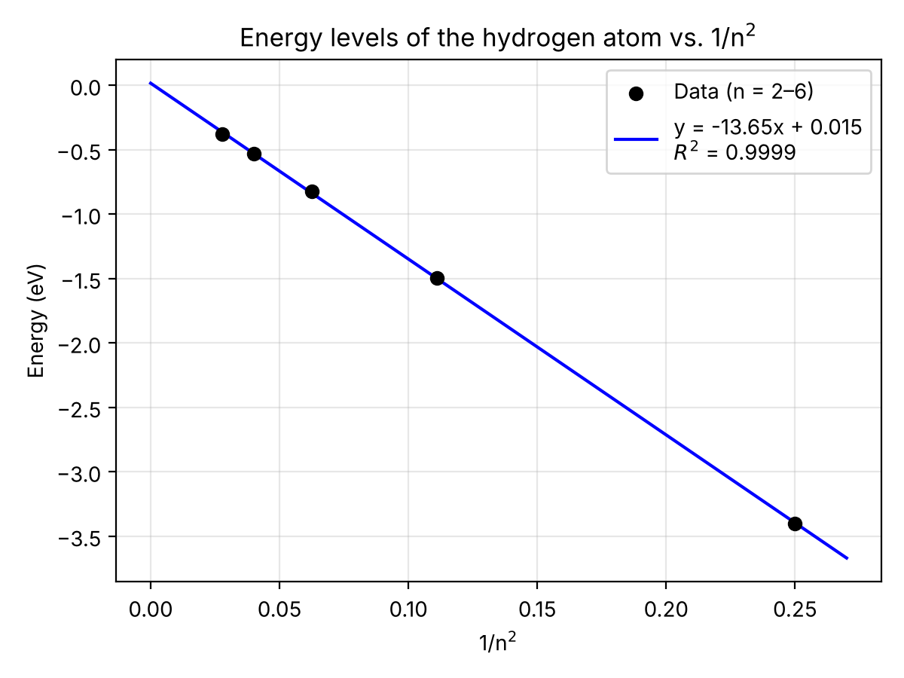

# Introduction

Diffraction is the bending and spreading of a wave when it passes through a narrow opening or around an edge. A diffraction grating has many evenly spaced grooves. Each groove acts as a new source of light waves, and these waves add together in some directions and cancel in others. On a screen, this makes a bright central spot with fainter spots on each side. In this experiment, red (633 nm) and green (532 nm) laser beams were passed through a diffraction grating onto a whiteboard. The distance from the grating to the board (*D*) and the distance from the central spot to the first diffracted spot (*y*~1~) were measured. These distances were used to find the spacing between grooves (*d*) with the equation:

$$\frac{\lambda}{d}=\sin\theta=\frac{y_1}{\sqrt{y_1^2+D^2}}$$

It was hypothesized that *y*~1~ depends on wavelength, so red light would diffract farther from the center than green light. It was also hypothesized that both lasers would give the same value of *d*, because the groove spacing is a property of the grating and not of the light. The wave theory of light supports both hypotheses, since diffraction and interference only happen with waves. The quantum theory of light treats light as photons with energy *E* = *hc*/*λ*, which connects each wavelength to a specific energy. Light behaves as a wave when it passes through the grating and as a particle when it is emitted or absorbed by atoms.

A hot bulb filament gives off all colors of visible light with no gaps, which is called a continuous spectrum. It was hypothesized that hydrogen would not do this. Instead, it would give off only a few bright lines of color, which is called a discrete spectrum. This is because the electron in hydrogen can only have certain energies. When it drops from a higher level to a lower one, it gives off light with energy equal to the difference between the two levels. For visible light, the electron always drops to *n* = 2. The expected wavelengths come from the equation below, where *R* = 2.179 × 10^−18^ J, *n*~f~ = 2, and *n*~i~ = 3, 4, 5, or 6. This predicts four lines at about 656, 486, 434, and 410 nm.

$$\Delta E=-\frac{hc}{\lambda}=-R\left(\frac{1}{n_f^2}-\frac{1}{n_i^2}\right)$$

# Data and Results

Table 1. Diffraction of red laser light (633 nm).

| | *D* (cm) | *y*~1~ (cm) | Calculated *d* (µm) |
|:--|:--:|:--:|:--:|
| Run 1 | 99.4 | 5.10 | 12.35 |
| Run 2 | 99.4 | 5.00 | 12.60 |
| Run 3 | 101.0 | 4.90 | 13.06 |
| Average | – | – | 12.7 |
| Standard Deviation | – | – | 0.4 |

Table 2. Diffraction of green laser light (532 nm).

| | *D* (cm) | *y*~1~ (cm) | Calculated *d* (µm) |
|:--|:--:|:--:|:--:|
| Run 1 | 99.4 | 5.10 | 10.38 |
| Run 2 | 100.7 | 5.10 | 10.52 |
| Run 3 | 99.1 | 4.90 | 10.77 |
| Average | – | – | 10.6 |
| Standard Deviation | – | – | 0.2 |

Table 3. Wavelengths and energies of light emitted by the excited hydrogen atom from higher energy levels to *n* = 2.

| | *λ* (nm) | *n*~i~ | *n*~f~ | 1/*n*~i~^2^ | Photon Energy (eV) | Hydrogenic Energy Level (eV) |
|:--|:--:|:--:|:--:|:--:|:--:|:--:|
| Wavelength 1 | 650.5 | 3 | 2 | 0.1111 | 1.901 | −1.499 |
| Wavelength 2 | 480.2 | 4 | 2 | 0.0625 | 2.575 | −0.825 |
| Wavelength 3 | 430.9 | 5 | 2 | 0.0400 | 2.870 | −0.530 |
| Wavelength 4 | 409.1 | 6 | 2 | 0.0278 | 3.023 | −0.377 |

Table 4. Line of best fit for energy levels of the hydrogen atom as a function of 1/*n*^2^.

| | Slope | *y*-Intercept | *R*^2^ Value | Energy of electron in ground state (eV) |
|:--|:--:|:--:|:--:|:--:|
| Line of Best Fit | −13.65 | 0.015 | 0.9999 | −13.6 |

{width=5in}

Figure 2. Visible emission spectrum of [element 1]. **[Insert image]**

Figure 3. Visible emission spectrum of [element 2]. **[Insert image]**

# Discussion

The groove spacing *d* was calculated from Run 1 of the red laser, where *D* = 99.4 cm, *y*~1~ = 5.10 cm, and *λ* = 0.633 µm. Rearranging the diffraction equation gives:

$$d=\frac{\lambda\sqrt{y_1^2+D^2}}{y_1}=\frac{(0.633\ \mu\text{m})\sqrt{(5.10\ \text{cm})^2+(99.4\ \text{cm})^2}}{5.10\ \text{cm}}$$

$$d=\frac{(0.633\ \mu\text{m})(99.53\ \text{cm})}{5.10\ \text{cm}}=12.35\ \mu\text{m}$$

The same method was used for all six measurements. For the red laser, the mean *d* was 12.67 µm with a standard deviation of 0.36 µm. For the green laser, the mean *d* was 10.56 µm with a standard deviation of 0.20 µm. Each standard deviation is in the tenths place, so *d* should be reported to 0.1 µm: 12.7 ± 0.4 µm for red and 10.6 ± 0.2 µm for green. This is about 2–3% of the mean, so each set of three measurements was fairly precise. However, the two lasers did not give the same *d*, which does not support the hypothesis that *d* depends only on the grating. The green *y*~1~ values (4.9–5.1 cm) were almost the same as the red ones. Since green light has a shorter wavelength, its first spot should have been closer to the center, about 4.2 cm away. The difference most likely comes from error in finding the center of the spots by eye, a tilted grating or board, or a recording mistake. The red laser did diffract at least as far as the green, which agrees with the wave theory, but the difference was smaller than expected.

For hydrogen, the four measured lines were 650.5, 480.2, 430.9, and 409.1 nm. Shorter wavelengths have more energy, so they come from higher starting levels. The lines were assigned to *n*~i~ = 3, 4, 5, and 6 in that order. Each photon energy was found with *E* = *hc*/*λ* and added to the *n* = 2 energy of −3.40 eV to get the energy of each higher level. For example, for the 650.5 nm line:

$$E_{\text{photon}}=\frac{hc}{\lambda}=\frac{(6.626\times10^{-34}\ \text{J·s})(2.99\times10^{8}\ \text{m/s})}{650.5\times10^{-9}\ \text{m}}=3.046\times10^{-19}\ \text{J}$$

$$E_{\text{photon}}=(3.046\times10^{-19}\ \text{J})\times\frac{1\ \text{eV}}{1.602\times10^{-19}\ \text{J}}=1.901\ \text{eV}$$

$$E_3=E_2+E_{\text{photon}}=-3.40\ \text{eV}+1.901\ \text{eV}=-1.499\ \text{eV}$$

Plotting the energy of levels *n* = 2 through 6 against 1/*n*^2^ gave a straight line (Figure 1) with *R*^2^ = 0.9999. The ground-state energy is found by setting *n* = 1, so 1/*n*^2^ = 1:

$$E=(-13.65\ \text{eV})\left(\frac{1}{n^2}\right)+0.015\ \text{eV}$$

$$E_1=(-13.65\ \text{eV})\left(\frac{1}{1^2}\right)+0.015\ \text{eV}=-13.6\ \text{eV}$$

The value is negative because *E* = 0 is the energy of a free electron fully separated from the proton (*n* = ∞). It is reported to three significant figures to match the precision of the wavelength readings on the spectroscope. This result matches the accepted value of −13.6 eV. The *R*^2^ close to 1 and the intercept close to zero confirm that the energy of hydrogen depends on 1/*n*^2^, as predicted.

Our model shows the hydrogen atom as a set of energy levels that get closer together as *n* increases. Each observed line is an electron falling from a higher level (*n* = 3 to 6) down to *n* = 2. The 650.5 nm red line is the smallest drop (3 → 2), and the 409.1 nm violet line is the largest (6 → 2). Because the levels are fixed, only these specific energies, and so only these colors, can be emitted. This explains why hydrogen and the other elements (Figures 2 and 3) showed separate bright lines, while the incandescent bulb showed a continuous rainbow. Each element has its own set of energy levels, so each one gives its own pattern of lines. This supports the hypothesis that atomic emission spectra are discrete.
